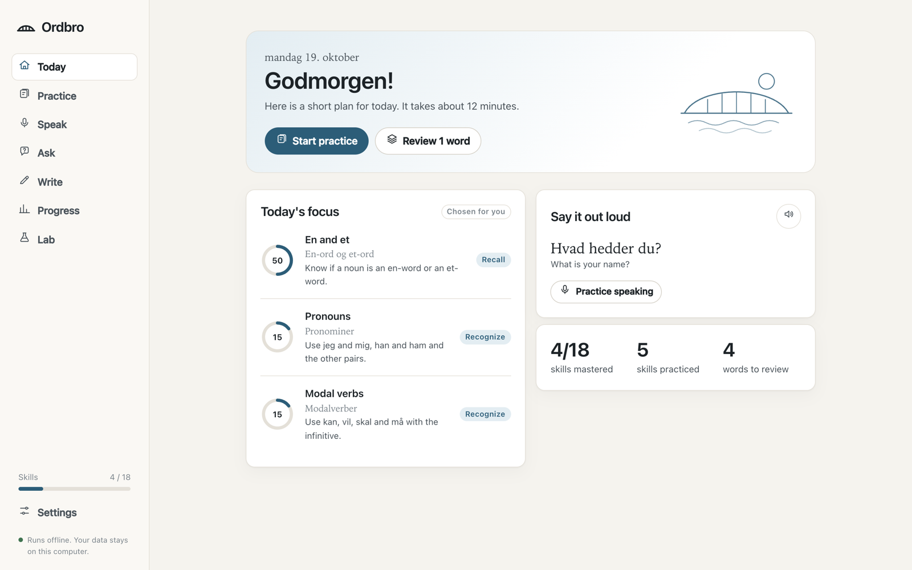
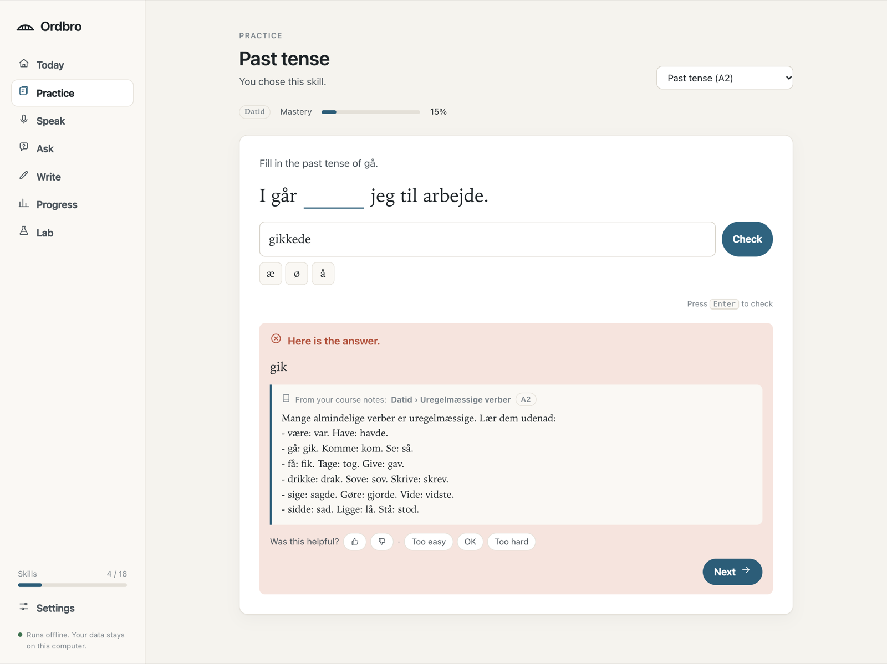
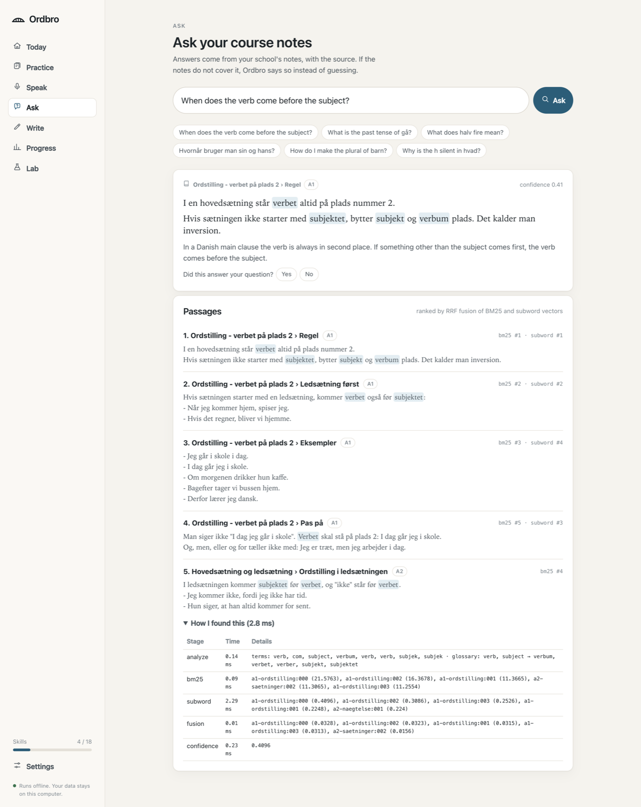
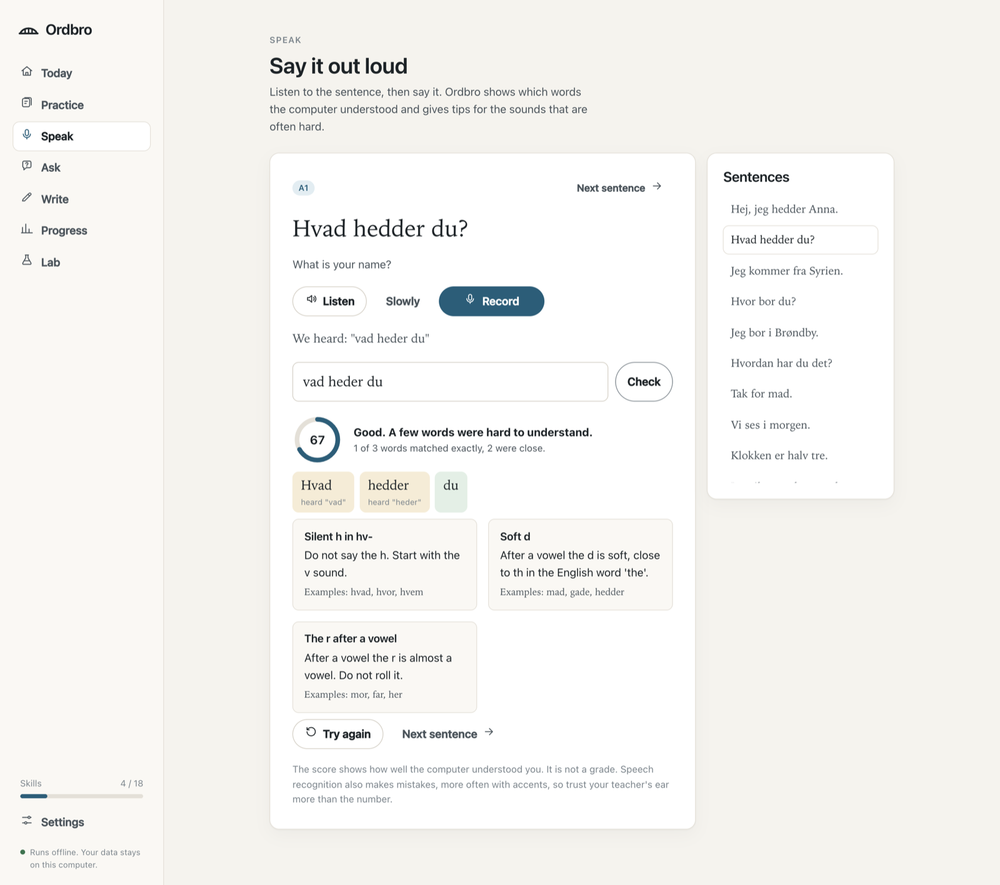

<p align="center">
  
</p>

<h1 align="center">Ordbro</h1>

<p align="center">
  An offline, knowledge-grounded assistant for learning Danish.
</p>

<p align="center">
  
  
  
  
</p>

<p align="center">
  
</p>

Ordbro (Danish for "word bridge") helps adult beginners learn Danish at level A1 to A2.
Every explanation comes from the school's own course notes, with the source shown, and
everything runs on the learner's computer without a large language model.
It is built on the [LinguaPilot RAG infrastructure](https://github.com/EU-ABPLA/linguapilot-rag-infrastructure)
and was developed within a European cooperation project on AI-supported personal language learning for adults.

## Features

- **Adaptive practice.** Knowledge tracing per skill picks tasks that are not too easy and not too hard. Support fades from multiple choice to free production as mastery grows. Words come back with spaced repetition.
- **Two-step feedback.** A wrong answer first gets a hint. A second wrong answer gets the right answer, a short explanation and the passage from the course notes.
- **Ask the notes.** Questions in English or Danish are answered from the notes with hybrid retrieval (BM25 + subword vectors + RRF). When the notes do not cover a question, Ordbro says so.
- **Speech practice.** Listen to a Danish voice, record yourself with the browser's speech recognition, and see word by word what was understood, with tips for hard Danish sounds.
- **Grammar feedback.** Eleven rules for typical beginner mistakes (word order, en/et, adjective endings, ikke, past tense and more), each linked to the rule in the notes.
- **Inclusive by design.** Large text, high contrast, wide spacing, dark mode, keyboard use, æ ø å buttons, and no accounts. Learner data stays in a local file.

| Practice | Ask | Speak |
|---|---|---|
|  |  |  |

## Quick start

Python 3.11 or newer is needed.

```bash
git clone https://github.com/zouge666/ordbro.git
cd ordbro
python3 -m venv .venv
.venv/bin/pip install -e ".[dev]"
.venv/bin/ordbro serve
```

Open <http://127.0.0.1:8000>. Speech recognition works in Chrome and Edge. In other browsers you can type what you said.

## Command line

```bash
ordbro ask "When does the verb come before the subject?" --trace
ordbro check "I dag jeg går i skole."
ordbro kb --preset c0
ordbro eval all
```

## Results

All studies run offline with `ordbro eval all` and are saved in [`eval/results`](eval/results).
The test sets are small and were written for this project, so the numbers are a first check.

| Retrieval, 73 test questions | Recall@3 | MRR | Right note at rank 1 |
|---|---|---|---|
| LinguaPilot, sparse route (`c0`) | 0.557 | 0.457 | 0.377 |
| LinguaPilot with nomic-embed-text (`c1n`) | 0.672 | 0.594 | 0.492 |
| Ordbro (`c6`) | **0.853** | **0.688** | **0.853** |

- Grammar checker: 94.6 % of the mistakes found, no false alarms on 40 correct sentences.
- Speech feedback: with 10 % recognition errors, using the best of three alternatives lowers false warnings from 9.8 % to 1.4 % of words.
- Simulated learners: after 60 items the adaptive policy reached 9.3 known skills, against 8.1 for book order and 7.2 for random order.

See [docs/evaluation.md](docs/evaluation.md) for the full tables and the known weak spots.

## Project layout

```
config/          settings (ordbro.toml)
data/            course notes, dialogues, vocabulary, glossary, skills, exercises
eval/            test sets and saved results
src/ordbro/
  nlp/           Danish tokenizer, Snowball stemmer, compound splitter, edit distance
  rag/           chunking, BM25, vectors, fusion, presets, answers with sources
  content/       loading the notes and the vocabulary lexicon
  tutor/         knowledge tracing, spaced repetition, skill graph, policy
  exercises/     exercise bank, generated drills, answer checking
  grammar/       rule-based grammar checker
  speech/        transcript alignment and pronunciation hints
  evaluation/    the four studies
  api/           FastAPI app
web/             build-free web app (HTML, CSS, ES modules)
tests/           pytest suite
```

More about the design is in [docs/architecture.md](docs/architecture.md).

## Configuration

Settings live in [`config/ordbro.toml`](config/ordbro.toml). The retrieval preset can be any step of the
ladder from `c0` (the original pipeline) to `ordbro`. A language model is not needed. To let an
OpenAI-compatible model write the answer from the retrieved passages, set:

```toml
[llm]
provider = "openai-compatible"
model = "your-model"
base_url = "https://api.example.com/v1"
```

and put the key in the `ORDBRO_LLM_API_KEY` environment variable. If the call fails, the extractive answer is used.

## Development

```bash
make test     # pytest and the JavaScript unit tests
make lint     # ruff
make eval     # all evaluation studies
```

## Acknowledgements

Made at the Technical University of Denmark within a European cooperation project on personal AI language
learning assistants, carried out together with language schools in several countries.
The retrieval core is adapted from [linguapilot-rag-infrastructure](https://github.com/EU-ABPLA/linguapilot-rag-infrastructure).
The Danish stemmer follows the [Snowball](https://snowballstem.org/algorithms/danish/stemmer.html) algorithm.

## License

[MIT](LICENSE)
