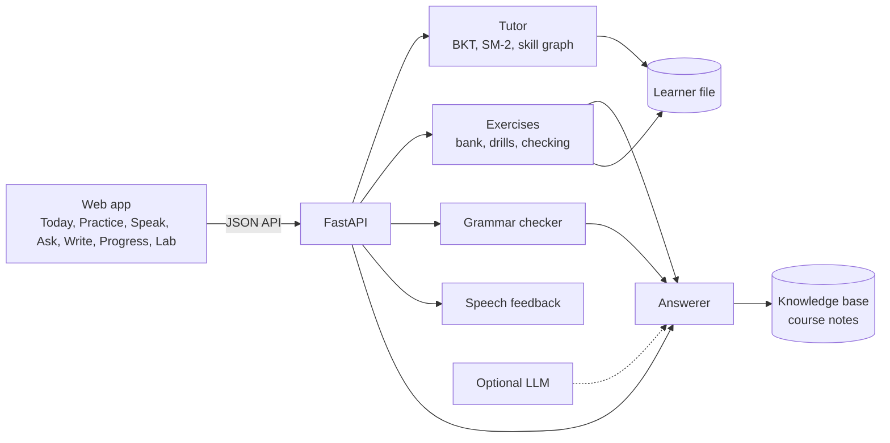

# Architecture

Ordbro is one Python service and a small web app. The service loads the course content once,
builds the knowledge base in memory and keeps learner state in one JSON file per learner.

## Knowledge base

The knowledge base follows the design of the LinguaPilot RAG infrastructure: an ingestion step and a
query step, two retrieval routes that are fused with Reciprocal Rank Fusion, and a trace for every query.

| Step | LinguaPilot (`c0`) | Ordbro (`ordbro`) |
|---|---|---|
| Tokens | `[A-Za-z0-9_]+`, æ ø å are lost | Unicode words |
| Terms | lower case | Snowball stems and compound parts |
| BM25 IDF | can be negative | never negative |
| Chunks | 800 characters, recursive | one per section |
| Index text | chunk text | title, English title, heading and English summary + text |
| Vector route | SHA-256 hash offline, or nomic-embed-text with Ollama | character n-gram TF-IDF, offline |
| Query | English stop words removed | language guess, glossary expansion, ae/oe/aa fixed |
| Filters | after fusion and cut-off | before retrieval |
| Answer | not part of the pipeline | extractive lines with source, or "I do not know" |

Each change is a preset in [`src/ordbro/rag/presets.py`](../src/ordbro/rag/presets.py), so it can be measured
on its own.

## Tutor

* **Knowledge tracing.** Every skill has a probability that the learner knows it. It is updated after the
  first attempt of every item with Bayesian Knowledge Tracing. Easy-to-guess items (multiple choice) count
  as weaker evidence.
* **Policy.** The next skill is the open skill whose predicted success is closest to 70 %. A skill opens when
  its prerequisites reach 60 %. The task type follows mastery: recognize, recall, then produce.
* **Words.** Vocabulary cards use SM-2. In mixed practice about every fifth item is a word card.

## Feedback in two steps

1. First wrong answer: a hint and a second try.
2. Second wrong answer: the right answer, a short explanation and the best matching passage from the note that
   belongs to the skill.

## Speech

The browser does speech recognition (Web Speech API, `da-DK`) and text to speech with the system's Danish voice.
The server aligns the transcript with the sentence word by word, picks the best of the recognizer's
alternatives, and adds spelling-based tips for hard Danish sounds. The score is never used to grade.

## API

| Method | Path | Purpose |
|---|---|---|
| GET | `/api/learner` | mastery, cards, history and today's plan |
| POST | `/api/practice/next` | next exercise (`focus`: skill id, `review` or empty) |
| POST | `/api/practice/answer` | check an answer (`attempt` 1 or 2) |
| POST | `/api/ask` | answer a question from the notes |
| POST | `/api/write/check` | grammar feedback for a text |
| POST | `/api/speak/assess` | feedback for a transcript and its alternatives |
| POST | `/api/feedback` | save a learner rating |
| GET | `/api/lab` | evaluation results and feedback summary |

Interactive documentation is at `/api/docs` while the server runs.

## Privacy

There are no accounts. Learner files and feedback are written to `var/` on the learner's computer.
Nothing is sent over the network unless the optional language model is turned on.
